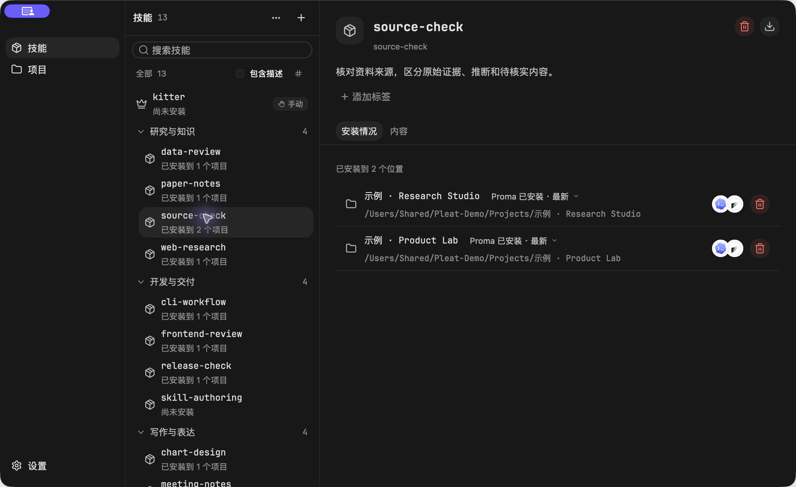
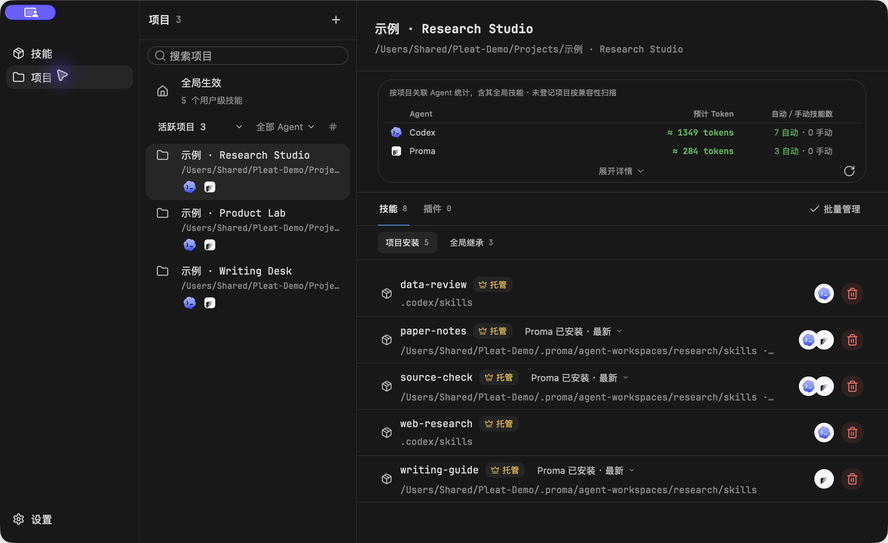
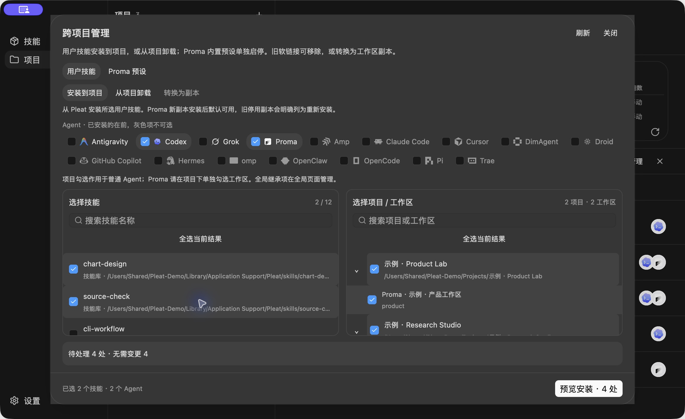

# Pleat

<p align="center">
  
</p>

<p align="center"><strong>English</strong> · <a href="README.zh-CN.md">简体中文</a></p>

<p align="center">
  <a href="LICENSE"></a>
  
  
</p>

Pleat is a skill manager based on [Kitter](https://github.com/what1f/kitter), with a desktop app and the `kitter` CLI. Maintain skill files in one library, see where they're installed, and check which Agents can discover them.

## What's added to Kitter

Kitter provides skill imports, a central library, Agent-specific installation and context estimates. Pleat continues from `v0.1.10` with these additions:

- Discover Codex local projects and native Proma workspaces, merge projects that point to the same directory, and archive, hide or restore entries in the project list.
- Install and sync skill copies in Proma workspaces. Identify managed origins, external links and local variants. Install or remove user skills; enable or disable verified built-in presets.
- Manage skills across several projects and Agents in one operation. Review target paths and the impact list before execution, then see which items failed.
- Group project skills by source, improve name and description search, detect installed Agents, and keep the selected project and workspace when opening management controls.
- Compare the source baseline, local files and incoming version before an update. Keep non-conflicting edits and stop on conflicts. Preserve each skill's `local-data/` and local adaptation notes.
- Move a library, switch to an existing one, or migrate legacy Kitter data into the Pleat directory. Compatibility links let existing installations keep reaching the same files.

## Using the app

### Find where a skill is installed

Add skills from local folders, GitHub, skills.sh-compatible sources or Claude plugin sources, or adopt existing installations. Select a skill to see the projects and Agents using it.



### Check a project's skills

The project view separates project installations, inherited global skills and plugins, with their sources. Codex and Proma can share a project while keeping their own installation paths and workspaces.



Skill counts and tokens come from directory scans and static estimates. They don't show what an Agent actually loaded or spent in a particular turn.

### Manage several projects

Choose skills, Agents and target projects, then preview the scope. Ordinary Agent installations use managed links. Proma uses workspace copies, which need syncing after their sources change.



These screenshots show the macOS app with isolated demo data. The top image was made with ImageGen. See [image provenance](assets/readme/README.md).

## Get Pleat

No Pleat GitHub Release has been published yet. You can build from source with Rust and Git; see the [CI configuration](.github/workflows/ci.yml) for desktop platform dependencies.

```sh
git clone https://github.com/caaaptaintop/Pleat.git
cd Pleat

# Build the CLI
cargo build --release --locked --bin kitter

# Run the desktop app
cargo run --release --locked --features desktop --bin kitter-desktop
```

On macOS, use `just` and the system command-line tools to produce the app and DMG:

```sh
just package
# target/release/Pleat.app
# target/release/Pleat-<version>-macos-<arch>.dmg
```

The current macOS build is ad hoc signed and hasn't been notarized by Apple. Gatekeeper may block its first launch. If you trust the package's source, follow [Apple's instructions](https://support.apple.com/en-us/102445): after trying to open it, go to **System Settings → Privacy & Security → Open Anyway**.

## CLI

The command is still named `kitter`. Put the built `target/release/kitter` on your `PATH` to inspect skills and projects:

```sh
kitter list
kitter projects --json
kitter project /path/to/project
```

Replace `skill-name` and the project path with your own values when installing or updating:

```sh
kitter install skill-name --project /path/to/project --target codex
kitter update skill-name
```

Use `--target universal` for the shared `.agents/skills` directory. Proma operations use registered native workspaces:

```sh
kitter proma workspaces --json
kitter proma status --workspace workspace-slug --json
```

Run `kitter --help` for more options. The bundled Agent skill is still [`kitter`](resources/skills/kitter).

## Data and compatibility

Default skill libraries for new installations:

| Platform | Location |
| --- | --- |
| macOS | `~/Library/Application Support/Pleat/skills` |
| Windows | `%LOCALAPPDATA%\Pleat\skills` |
| Linux | `$XDG_DATA_HOME/Pleat/skills` or `~/.local/share/Pleat/skills` |

Existing Kitter data stays in place until you migrate it under **Settings → Advanced storage settings**. Migration keeps old-path compatibility links. Cross-volume moves, conflicting targets and directory-identity mismatches stop the operation.

Local adaptations can live in a skill's `local-data/ADAPTATION.md`, loaded through host instructions. `local-data/` stays with the source skill and isn't copied into Proma's skill package.

<details>
<summary>Custom locations and compatibility identifiers</summary>

```sh
kitter library
# Switch to an existing nonempty library; use the desktop action to move into an empty folder.
kitter library --set /absolute/path/to/existing/library
```

`KITTER_HOME` sets the application-data root. An incomplete metadata transaction blocks reopening until the saved recovery material is resolved.

Bundle ID `dev.kitter.app`, the internal `Kitter` executable, Cargo package name and configuration format remain unchanged, so existing scripts and installation paths don't need rewriting for the new product name.

</details>

## Platform status

| Platform | Verification |
| --- | --- |
| macOS ARM64 | Desktop app, CLI, packaging and isolated demo operations verified locally. |
| macOS Intel | Core tests and desktop compilation checked in CI. |
| Windows x64 | Core tests and desktop compilation checked in CI. |
| Linux x64 | Core tests and desktop compilation checked in CI. |

The native desktop experience still needs testing on Windows, Linux and Intel Mac. See [GitHub Actions](https://github.com/caaaptaintop/Pleat/actions) for checks on a specific commit.

## Upstream and license

The foundation comes from [what1f/kitter](https://github.com/what1f/kitter); this repository's changes are recorded in its commit history. Please use [Pleat Issues](https://github.com/caaaptaintop/Pleat/issues) for questions and suggestions.

Distributed under [Apache License 2.0](LICENSE), retaining upstream copyright and license notices. See [THIRD_PARTY_LICENSES.md](THIRD_PARTY_LICENSES.md) for bundled material and [assets/brand](assets/brand/README.md) for the icon sources and export steps.
